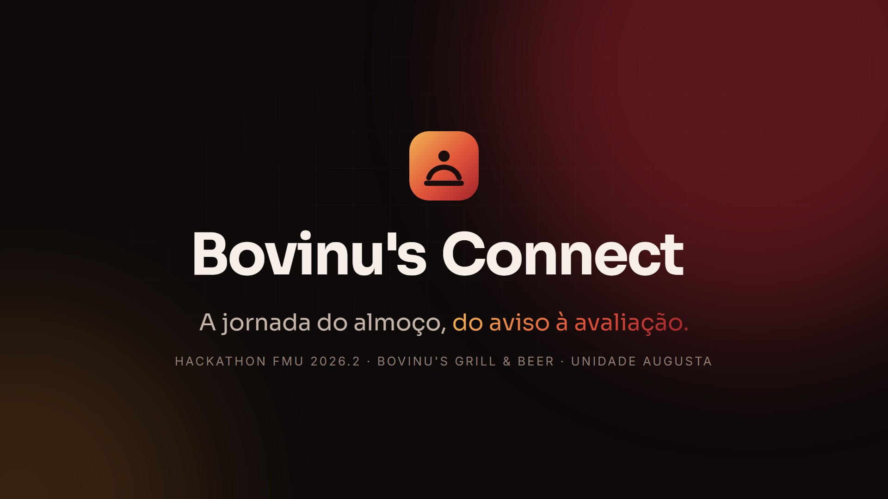
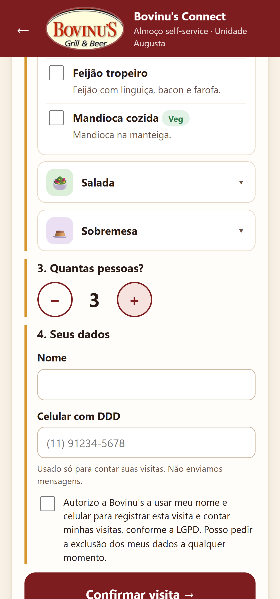
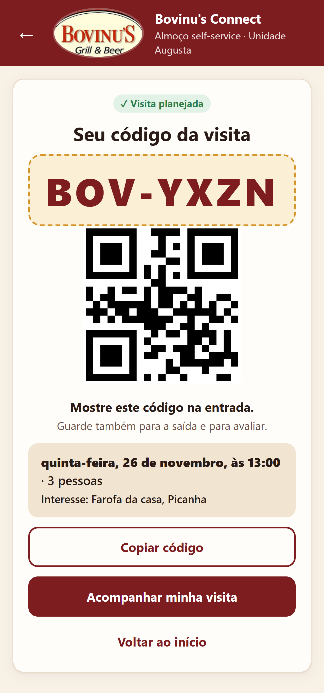
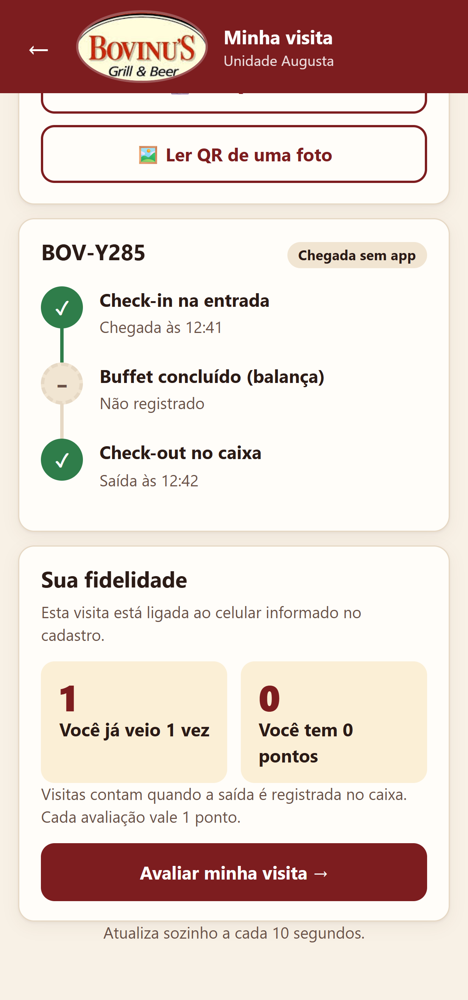
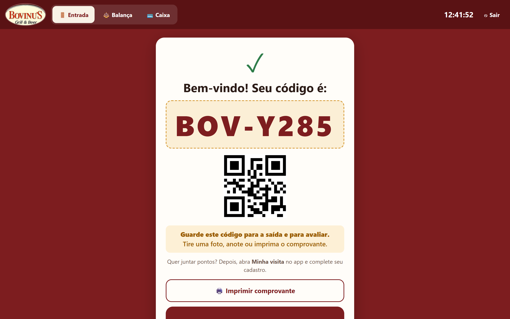
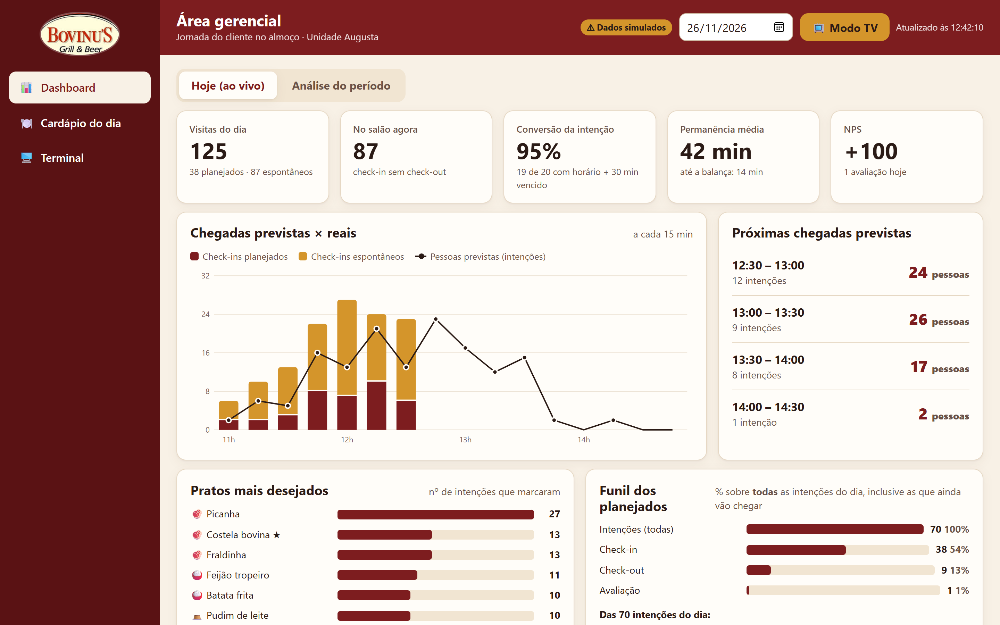
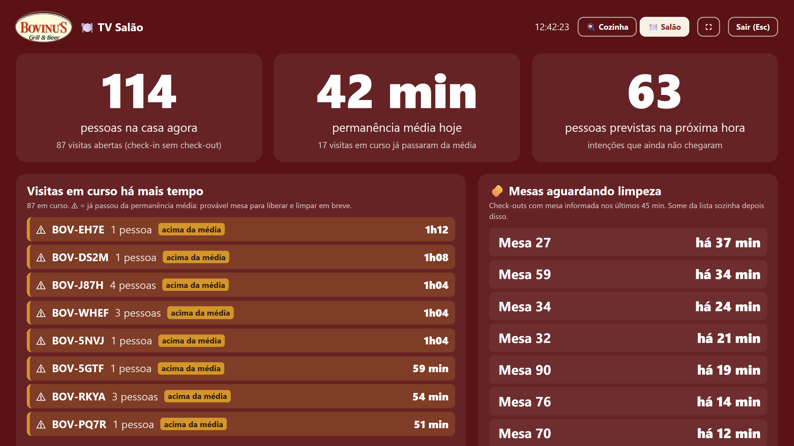
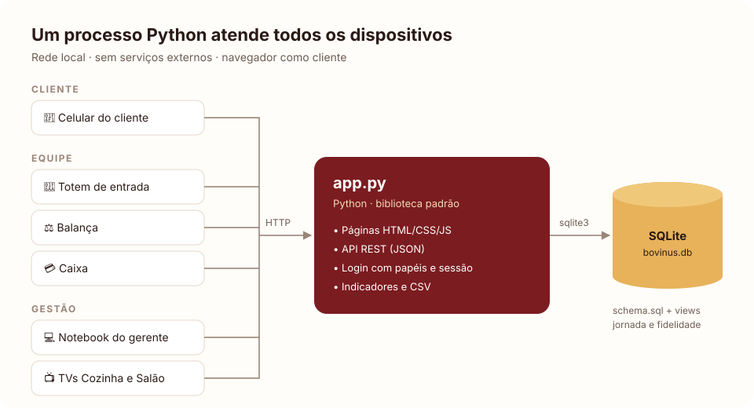

# Bovinu's Connect

Projeto da equipe **Janaina Costa, Vitor Nunes e Matheus Vaccari** para o **Hackathon FMU 2026.2**, com o desafio da
**Bovinu's Grill & Beer** (Unidade Augusta).

> O cliente avisa que vem e o que quer encontrar no buffet. A equipe registra chegada, balança e saída com um único
> código. A gestão passa a ver, ao vivo, uma jornada que antes ninguém media.

| | |
| --- | --- |
| 🌐 **Site do projeto** | [jnnkoc.github.io/bovinus-connect](https://jnnkoc.github.io/bovinus-connect/) — demonstração estática com as telas e simulações |
| 🎬 **Vídeo (1min43)** | [video/bovinus-connect.mp4](video/bovinus-connect.mp4) — motion design com as telas reais |
| 🖥️ **Apresentação** | [PDF](slides/bovinus-connect.pdf) · [PPTX editável](slides/bovinus-connect.pptx) |
| 📄 **Documentação** | [Visão geral](docs/01-visao-geral.md) · [Requisitos](docs/02-requisitos.md) · [Jornada e telas](docs/03-jornada-e-telas.md) · [Diagramas e DER](docs/04-diagramas-e-der.md) · [PDFs](docs/pdf/) · [Especificação](docs/ESPECIFICACAO.md) |
| 🚀 **Evolução** | [Próximos passos e diferencial](#próximos-passos-e-evolução) |
| 💻 **Rodar o MVP** | [Como rodar](#como-rodar) — Python 3.10+, sem pacotes extras |

[](video/bovinus-connect.mp4)

<sub>Clique na imagem para abrir o vídeo.</sub>

> **Sobre os dados:** todos os números das telas vêm de `seed.py` e são **simulados**. Nenhum número é resultado real da
> Bovinu's, e o MVP não foi testado em operação no restaurante. Os ganhos descritos no site e nos slides são **hipóteses**.

## O problema e a resposta

| Dor apresentada | Como o Connect responde |
| --- | --- |
| **Mix do prato:** sabe-se o peso vendido, não o que o cliente queria encontrar | Intenção de visita com até 3 pratos de interesse; ranking do dia no dashboard (preferência declarada, não consumo) |
| **Filas e tempo** sem medição no buffet, na churrasqueira e no caixa | Check-in, balança e caixa registram horários: tempo até a balança, permanência, previsto × real a cada 15 min |
| **Limpeza:** não se sabe quando a mesa ficou livre | Mesa informada no check-out entra em "Mesas aguardando limpeza" na TV Salão por 45 min |
| **Qualidade:** opiniões não são capturadas | Avaliação com NPS, notas de buffet, espera e atendimento; cada avaliação vale 1 ponto de fidelidade |

## O que o MVP faz

- **App do cliente:** planejar visita (dia, horário, pessoas, até 3 pratos, LGPD), código `BOV-XXXX` com QR,
  **Minha visita** (status ao vivo, cadastro do espontâneo, visitas e pontos) e avaliação.
- **Terminal da equipe:** Entrada, Balança (opcional) e Caixa (com mesa); cliente espontâneo com comprovante impresso;
  leitura de QR pela câmera, leitor USB ou digitação.
- **Gestão:** dashboard ao vivo, análise do período com insights por regras e CSV, TV Cozinha, TV Salão, cardápio do dia.
- **Segurança:** login com papéis (gerente e atendente), senhas PBKDF2, bloqueio após 5 tentativas.
- **Qualidade:** 21 testes automatizados (`testes.py`).

| | | |
| --- | --- | --- |
|  |  |  |
| Planejar visita | Código + QR | Minha visita e fidelidade |
|  |  |  |
| Totem: espontâneo | Dashboard · Hoje | TV Salão |

Todas as 27 capturas estão em [`prints/`](prints/).

## Arquitetura



Um único processo Python (`app.py`, biblioteca padrão) serve as páginas e a API REST e grava no SQLite. Sem frameworks,
sem CDN e sem serviços externos. O DER e o dicionário de dados estão em [docs/04-diagramas-e-der.md](docs/04-diagramas-e-der.md).

## Próximos passos e evolução

O MVP já registra o que as próximas fases precisam: o **código da visita**, o **celular com consentimento**, a **mesa**
e os **horários da jornada**. Por isso o Connect pode crescer por partes, sem trocar de sistema. Esse é o nosso
diferencial competitivo.

| Fase | Evolução (ainda não implementada) | Aproveita do MVP |
| --- | --- | --- |
| **1 · MVP atual** ✅ | Intenção de visita, jornada com código, fidelidade simples, dashboard e TVs | — |
| **2 · Relacionamento** | **Fidelidade robusta** com níveis, benefícios e resgate de pontos, no padrão de grandes redes de franquias | Visitas e pontos por celular (view `fidelidade`) |
| | **Comunicação com o cliente**: campanhas segmentadas por frequência e preferência, com consentimento, em todas as unidades | Celular com aceite LGPD e pratos de interesse |
| **3 · Salão conectado** | **Tablet na mesa** para chamar o garçom | Mesa registrada na visita e TV Salão |
| | **PDV mobile** para garçons anotarem pedidos, com visão mais fina de demanda e limpeza | Terminal web com papéis e lista de limpeza |
| | **Balanças inteligentes**: dados de pratos e cubas alimentando os dashboards | Etapa Balança e tempo até a balança |
| **4 · Reservas para grupos** | **Espaço reservado para grandes equipes**, com número de mesas definido | Intenção de visita com horário e nº de pessoas |

## Estrutura do repositório

```text
bovinus-connect/
├── app.py, schema.sql, seed.py, usuarios.py, testes.py   ← o MVP (backend Python + SQLite)
├── *.html, estilo.css, comum.js, img/, vendor/           ← telas do MVP servidas pelo app.py
├── index.html          ← só para o GitHub Pages: redireciona para site/ (o app.py não usa)
├── site/               ← site institucional publicado (build estático, gerado a partir de site-src/)
├── site-src/           ← código-fonte do site (React + Vite)
├── video/              ← vídeo final (MP4) e capa
├── video-src/          ← código-fonte do vídeo (Remotion)
├── slides/             ← apresentação (PPTX editável, PDF e capa)
├── prints/             ← capturas das telas do MVP (dados simulados)
└── docs/               ← documentação (Markdown), PDFs e diagramas SVG
```

---

# Detalhes técnicos do MVP

## Como rodar

Requisito: **Python 3.10+** (só biblioteca padrão, nenhum pacote extra).

```bash
py seed.py      # (opcional) apaga e recria bovinus.db com dados simulados
py app.py       # inicia o servidor
```

No Linux/macOS use `python3`. No Windows também dá para dar dois cliques em **`iniciar.bat`**: ele cria os dados simulados
se o banco não existir, abre o dashboard e sobe o servidor.

Abra http://127.0.0.1:8000. O servidor também aceita conexões da rede local e mostra, ao iniciar, o endereço para abrir
**no celular na mesma rede Wi-Fi** (o Windows pode pedir permissão no firewall na primeira vez).
Variáveis opcionais: `BOVINUS_PORTA` (padrão 8000), `BOVINUS_HOST` (padrão `0.0.0.0`; use `127.0.0.1` para só este computador)
`BOVINUS_BANCO` (caminho do arquivo SQLite), `DEMO_AGORA` (ver abaixo) e `JANELA_LIMPEZA_MIN` (padrão 45: por quantos
minutos a mesa fica em "Mesas aguardando limpeza" na TV Salão).

### Horário de demonstração (`DEMO_AGORA`)

Para a apresentação funcionar a qualquer hora, há um "agora" de demonstração (padrão **12:40**):

- `py seed.py` gera o almoço de hoje só entre 11h e `DEMO_AGORA`, com intenções futuras até 14h45.
- Com dados simulados e **fora do horário de almoço (11h–15h)**, a aba **Hoje** do dashboard usa `DEMO_AGORA` como
  "agora" (selo **🕐 Agora simulado** no topo). Dentro do almoço vale o horário real (no seed e no app).
- Mude no topo do `seed.py` ou pela variável de ambiente, que vale para os dois:
  `$env:DEMO_AGORA="13:15"` (PowerShell) ou `set DEMO_AGORA=13:15` (cmd), depois `py seed.py` e `py app.py`.
  O seed grava o valor no banco; a variável de ambiente tem prioridade. `DEMO_AGORA=off` desliga.

## Login da equipe

As telas `/terminal`, `/cardapio` e `/dashboard` (e as rotas da API que elas usam) exigem login em `/login`.

| Papel | Acessa |
| --- | --- |
| `gerente` | Dashboard, cardápio do dia e terminal |
| `atendente` | Só o terminal |

- **Com `py seed.py`** são criados usuários de **demonstração**: `gerente` / `bovinus-demo` e `atendente` / `terminal-demo`
  (definidos no topo do `seed.py`). Servem só para a apresentação.
- **Sem o seed**, na primeira vez que o `app.py` roda ele cria `gerente` e `atendente` com **senhas aleatórias** e as mostra
  no terminal. Para escolher as senhas, defina `BOVINUS_SENHA_GERENTE` e `BOVINUS_SENHA_ATENDENTE` antes de iniciar.
- Gerenciar usuários: `py usuarios.py listar`, `py usuarios.py criar <login> <gerente|atendente> "<Nome>"`,
  `py usuarios.py senha <login>`, `py usuarios.py desativar <login>`.
- Senhas guardadas com PBKDF2-SHA256 (200 mil iterações, sal próprio). Sessão de 12 h em cookie `HttpOnly` e `SameSite=Strict`;
  o banco guarda só o hash do token. Após 5 senhas erradas, o login fica bloqueado por 5 minutos.

## QR code

- O app do cliente mostra o QR do código da visita (tela do código e `/minha-visita`); o totem mostra o QR do espontâneo
  e imprime o comprovante com o QR.
- Em `/minha-visita`, o cliente lê o QR com **📷 Ler QR code** (câmera ao vivo, só em localhost/HTTPS) ou
  **🖼️ Ler QR de uma foto** (abre a câmera do celular e funciona também pelo IP da rede, em HTTP).
- No terminal, **📷 Ler QR code pela câmera** registra a etapa assim que lê o código. Também funciona leitor USB de QR
  (ele "digita" o código e envia Enter) e digitar o código.
- O navegador só libera a câmera em **localhost (127.0.0.1) ou HTTPS**. Pelo IP da rede (`http://192.168...`) o botão some
  e aparece o aviso; nesse caso use leitor USB ou digite o código.
- Bibliotecas locais em `vendor/` (ver `vendor/LEIAME.md`).

## Testes

```bash
py testes.py
```

Sobe o servidor numa porta livre com um banco temporário (não mexe no `bovinus.db`) e testa login, papéis, jornada
planejada e espontânea, regras da intenção, fidelidade (visitas e pontos por celular), completar cadastro do
espontâneo, TVs Cozinha e Salão (inclusive a mesa sumindo da lista após 45 min e o modo demonstração), cardápio,
dashboard, CSV e bloqueio de caminhos.

## Telas

| Rota | Arquivo | Para quem | O que faz |
| --- | --- | --- | --- |
| `/` | `cliente.html` | Cliente (celular) | Cardápio do dia, **Planejar visita** (dia, horário, até 3 pratos, pessoas, nome, celular e aceite LGPD) → código `BOV-XXXX` |
| `/minha-visita` | `minha-visita.html` | Cliente | Digita ou lê por QR (câmera ou foto) o código, planejado ou espontâneo. Mostra check-in, buffet e check-out (atualiza a cada 10 s). Sem celular vinculado (espontâneo): **Completar cadastro** (nome, celular, LGPD). Com cadastro: "Você já veio X vezes", "Você tem Y pontos" e o botão **Avaliar** |
| `/avaliar` | `avaliar.html` | Cliente | Após a saída: NPS 0–10 + notas 1–5 de Buffet, Espera e Atendimento + comentário. Ao enviar, mostra visitas e pontos |
| `/terminal` | `terminal.html` | Totem e equipe | Modos **Entrada** (check-in pelo código ou "Sou cliente espontâneo"), **Balança** (buffet concluído, opcional) e **Caixa** (check-out + mesa opcional). O sistema registra a etapa do modo; confirmação de 2 s e volta ao início (no check-in, 8 s com **🖨️ Imprimir comprovante**; no espontâneo, também). `?modo=caixa` abre direto no modo |
| `/cardapio` | `cardapio.html` | Gerente | Cardápio por data: adicionar, editar, remover, destaque, vegetariano, copiar do dia anterior, prévia do app |
| `/dashboard` | `dashboard.html` | Gerente | **Hoje (ao vivo)**: cartões, chegadas previstas × reais por 15 min, próximas chegadas, pratos desejados, funil dos planejados. **📺 Modo TV**: escolha **TV Cozinha** ou **TV Salão** antes da tela cheia (ou abra `/dashboard#tv-cozinha` / `#tv-salao`). **Análise**: tendências, insights por regras, satisfação, comentários, recorrência, pratos pouco desejados, visitas recentes, exportar CSV |

## Fluxo da demonstração

1. `py seed.py` e `py app.py`.
2. `/cardapio` (login `gerente` / `bovinus-demo`): confira o cardápio de hoje (ou copie o do dia anterior).
3. `/` no celular: **Planejar visita** → anote o código `BOV-XXXX`.
4. `/terminal?modo=entrada`: digite o código → check-in. Teste também **Sou cliente espontâneo**.
5. `/terminal?modo=balanca` (opcional) e `/terminal?modo=caixa` → saída.
6. `/minha-visita?codigo=BOV-XXXX` → status, fidelidade e **Avaliar** (no espontâneo, complete o cadastro antes).
   No totem, **Imprimir comprovante** abre o diálogo de impressão (sem impressora: cancele ou salve como PDF).
7. `/dashboard`: veja os números mudarem (atualiza a cada 10 s).

## Banco (SQLite, `schema.sql`)

`cliente` · `prato` · `cardapio_dia` · `intencao` · `intencao_prato` · `visita` · `avaliacao` · `usuario` · `sessao` · `parametro`, e as views `jornada` e `fidelidade`.

- **Fidelidade** (view, calculada na consulta): por cliente/celular, `visitas` = visitas com check-out e `pontos` =
  avaliações registradas. A visita chega ao cliente pelo `cliente_id` dela ou pelo da intenção correspondente;
  a avaliação segue a visita. No espontâneo, o vínculo é feito em **Completar cadastro**.

- Horários gravados em **UTC ISO 8601**; exibidos em `America/Sao_Paulo` (UTC−3 fixo, sem horário de verão).
- `visita` tem código próprio e `origem` (`planejado` | `espontaneo`). No planejado, o código da intenção vira o código da visita no check-in.
- O **buffet é opcional**: o check-out só exige o check-in.
- Visita aberta há mais de 3 h é fechada com `saida_estimada = 1` e fica fora da permanência média.
- Códigos `BOV-XXXX` sem 0/O e 1/I, únicos entre intenções e visitas.
- `PRAGMA user_version = 2`. Se existir um `bovinus.db` da versão anterior, o `app.py` o renomeia para `bovinus.db.v1.bak` e cria um novo.

## Contrato da API

**Acesso:** públicas (app do cliente): `GET /api/cardapio`, `POST /api/intencoes`, `GET /api/jornadas/{codigo}`,
`POST .../avaliacao`, `POST .../cadastro`. **Equipe** (gerente ou atendente): `POST /api/visitas` e `POST .../proxima`. **Só gerente**: escrita
no cardápio, `/api/dashboard/*`, `/api/visitas.csv` e `/api/clientes/*`. Sem login → 401; papel sem acesso → 403.

Corpo e respostas em JSON (envie `Content-Type: application/json`). Erros retornam `{"erro": "mensagem"}` com 400 (dados inválidos), 404 (não encontrado) ou 409 (conflito ou etapa fora de ordem).
O código aceita `BOV-ABCD`, `bov-abcd` ou só `ABCD`.

| Método e rota | Corpo | Resposta |
| --- | --- | --- |
| `POST /api/login` | `{login, senha}` | `{login, nome, papel}` + cookie de sessão (401 senha errada, 429 bloqueado) |
| `POST /api/logout` | — | encerra a sessão |
| `GET /api/eu` | — | usuário logado ou 401 |
| `GET /api/cardapio?data=AAAA-MM-DD` | — | `{data, pratos:[{id, nome, categoria, descricao, vegetariano, destaque}]}` (sem `data` = hoje) |
| `POST /api/cardapio/{data}` | `{nome, categoria, descricao?, vegetariano?, destaque?}` | 201 + cardápio do dia |
| `PUT /api/cardapio/{data}/{prato_id}` | mesmos campos | cardápio do dia |
| `DELETE /api/cardapio/{data}/{prato_id}` | — | cardápio do dia (o prato sai só daquele dia) |
| `POST /api/cardapio/{data}/copiar-anterior` | — | cardápio do dia + `copiado_de` |
| `POST /api/intencoes` | `{horario_previsto, pessoas, pratos:[ids, até 3], nome, celular, aceite_lgpd:true}` | 201 + visita |
| `POST /api/visitas` | — | 201 + visita espontânea já com check-in |
| `GET /api/jornadas/{codigo}` | — | visita (sem dados pessoais) |
| `POST /api/jornadas/{codigo}/proxima` | `{modo: "entrada" \| "balanca" \| "caixa", mesa?}` | `{etapa, repetido, horario, mensagem, visita}` |
| `POST /api/jornadas/{codigo}/avaliacao` | `{nota_nps 0–10, nota_buffet, nota_espera, nota_atendimento 1–5, comentario?}` | 201 + visita |
| `POST /api/jornadas/{codigo}/cadastro` | `{nome, celular, aceite_lgpd:true}` | visita, agora com cadastro. Celular novo cria o cliente; existente usa o cadastro (409 se a visita já tem cadastro) |
| `GET /api/clientes/{celular}` | — | `{visitas, pontos}` |
| `GET /api/dashboard/hoje?data=` | — | cartões, série por 15 min, próximas chegadas, pratos, funil |
| `GET /api/dashboard/tv` | — | TVs: `na_casa`, `previstas_proxima_hora`, `prato_top`, `balanca_media`, `permanencia_media`, `em_curso` (com `acima_media`), `mesas_limpeza` |
| `GET /api/dashboard/analise?inicio=&fim=` | — | resumo, dias, satisfação, comentários, recorrência, pratos pouco desejados, recentes, insights (padrão: últimos 7 dias) |
| `GET /api/visitas.csv?inicio=&fim=` | — | CSV (`;`, UTF-8 com BOM para o Excel) |

**Visita** = `{codigo, origem, status: "aguardando" | "em_andamento" | "encerrada", horario_previsto, pessoas, pratos:[nomes],
check_in_em, buffet_concluido_em, check_out_em, saida_estimada, mesa, avaliada, cadastro, visitas_cliente, pontos_cliente}`
(`visitas_cliente` e `pontos_cliente` são `null` sem cadastro).

**`/proxima`**: em `entrada`, faz o check-in (intenção marcada para outro dia → 409 com `outro_dia: true` e `"Esta visita está marcada para DD/MM."`; o terminal oferece **Registrar como espontâneo**); em `balanca`, registra o buffet (exige check-in); em `caixa`, registra o check-out
(exige check-in; substitui uma saída estimada). Repetir uma etapa não altera nada e devolve `repetido: true` com o horário original.

## Indicadores

Definições em `docs/ESPECIFICACAO.md` ("Definição dos indicadores"): conversão da intenção (só planejados, após previsto + 30 min),
planejados × espontâneos, no salão agora, permanência (só check-out real), tempo até a balança, NPS, satisfação por tema,
recorrência por celular, chegadas previstas (pessoas) × reais (check-ins) por 15 min e pratos desejados.

## Segurança e privacidade (limites do MVP)

- Telas e rotas da equipe protegidas por login (ver acima). As senhas de demonstração do `seed.py` são públicas:
  troque-as (`py usuarios.py senha <login>`) antes de qualquer uso fora da apresentação.
- O servidor usa HTTP simples. Para publicar na internet, coloque-o atrás de HTTPS (proxy reverso) — isso também libera a câmera.
- A consulta pública da visita não devolve nome nem celular. O celular só é usado para contar visitas, com aceite LGPD registrado.

## Próximos passos (fora deste MVP)

Ver [Próximos passos e evolução](#próximos-passos-e-evolução), no início deste README.
