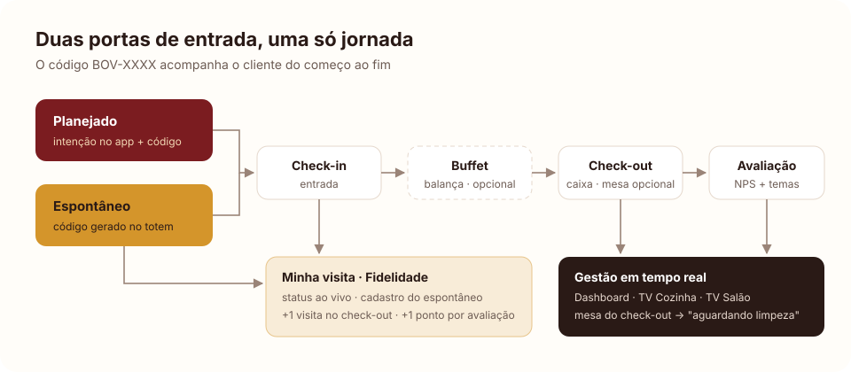

# Jornada e telas

Mapa das telas do cliente e da equipe e a jornada completa, planejada e espontânea.

O **código da visita** é o fio condutor: nasce na intenção (app) ou no totem (espontâneo) e é o mesmo até a
avaliação. A avaliação só é liberada depois do check-out.

## Telas do cliente

| Tela | Rota | O que mostra |
| --- | --- | --- |
| Início | `/` | Boas-vindas, cardápio do dia por categoria, atalhos para planejar, acompanhar e avaliar |
| Planejar visita | `/#planejar` | Dia, horário, até 3 pratos de interesse, nº de pessoas, nome, celular, LGPD |
| Código da visita | `/#codigo` | Código `BOV-XXXX` + QR, resumo da intenção, "Acompanhar minha visita" |
| Minha visita | `/minha-visita?codigo=...` | Check-in → buffet → check-out, completar cadastro (espontâneo), visitas e pontos, botão Avaliar |
| Avaliar | `/avaliar?codigo=...` | NPS 0–10, notas 1–5 (buffet, espera, atendimento), comentário; ao enviar, mostra visitas e pontos |

## Telas da equipe

| Tela | Rota | Papel | O que mostra |
| --- | --- | --- | --- |
| Login | `/login` | atendente, gerente | Usuário e senha |
| Terminal | `/terminal` | atendente, gerente | Modos Entrada, Balança e Caixa; QR ou digitação; espontâneo e comprovante |
| Dashboard | `/dashboard` | gerente | Aba Hoje, aba Análise do período, Modo TV (Cozinha e Salão) |
| Cardápio do dia | `/cardapio` | gerente | Pratos do dia, cadastro e edição, copiar do dia anterior, prévia do app |

## Jornada passo a passo

1. **Planejado:** o cliente planeja pelo app e recebe o código. **Espontâneo:** toca em "Sou cliente espontâneo" no
   totem e recebe o código na tela (e no comprovante impresso, se quiser).
2. **Check-in** no terminal de entrada (o espontâneo já entra com check-in feito).
3. **Buffet concluído** na balança (opcional).
4. **Check-out** no caixa, com o número da mesa (opcional). A mesa aparece na TV Salão como "aguardando limpeza".
5. **Minha visita:** o espontâneo pode completar o cadastro (nome, celular, LGPD) para ganhar fidelidade.
6. **Avaliação:** NPS e notas por tema; cada avaliação soma 1 ponto ao celular do cliente.
