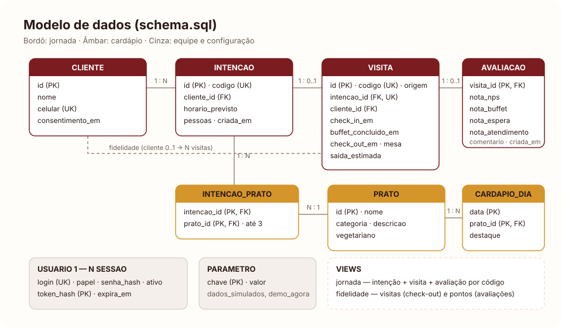
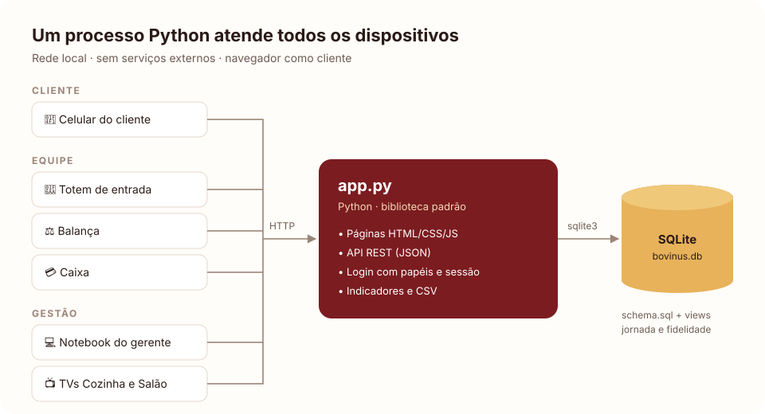

# Diagramas e DER

Casos de uso, modelo de dados e arquitetura. O dicionário abaixo reflete o `schema.sql` do repositório.

## Casos de uso

| Ator | Caso de uso |
| --- | --- |
| Cliente planejado | Planejar visita (dia, horário, pratos, pessoas) |
| Cliente (ambos) | Acompanhar a visita pelo código |
| Cliente espontâneo | Obter código no totem de entrada |
| Cliente espontâneo | Completar cadastro de fidelidade pelo código |
| Cliente (ambos) | Avaliar a visita |
| Atendente | Registrar check-in, buffet concluído e check-out (com mesa opcional) |
| Atendente | Gerar código do espontâneo e imprimir comprovante |
| Gerente | Consultar dashboard (Hoje e Análise) e exportar CSV |
| Gerente | Abrir Modo TV (Cozinha / Salão) |
| Gerente | Gerenciar cardápio do dia |

## Modelo de dados (DER)

## Dicionário de dados

Datas e horários são texto ISO 8601 em UTC. Booleanos são inteiros 0/1.

### cliente

| Campo | Tipo | Descrição |
| --- | --- | --- |
| id | INTEGER, PK | Identificador |
| nome | TEXT | 2 a 80 caracteres |
| celular | TEXT, UNIQUE | Só dígitos, com DDD (10 ou 11); identifica o cliente na fidelidade |
| consentimento_em | TEXT | Momento do aceite LGPD |

### intencao

| Campo | Tipo | Descrição |
| --- | --- | --- |
| id | INTEGER, PK | Identificador |
| codigo | TEXT, UNIQUE | `BOV-XXXX`; vira o código da visita no check-in |
| cliente_id | FK → cliente | Quem planejou |
| horario_previsto | TEXT | Chegada prevista |
| pessoas | INTEGER | 1 a 20 |
| criada_em | TEXT | Quando a intenção foi registrada |

### prato · cardapio_dia · intencao_prato

| Tabela | Campos |
| --- | --- |
| prato | id (PK), nome, categoria (churrasco, acompanhamento, salada, sobremesa), descricao (até 120), vegetariano |
| cardapio_dia | data + prato_id (PK composta), destaque |
| intencao_prato | intencao_id + prato_id (PK composta); até 3 por intenção (regra da API) |

### visita

| Campo | Tipo | Descrição |
| --- | --- | --- |
| id | INTEGER, PK | Identificador |
| codigo | TEXT, UNIQUE | `BOV-XXXX` |
| origem | TEXT | `planejado` ou `espontaneo` (planejado ⇔ tem intencao_id) |
| intencao_id | FK → intencao, UNIQUE, nulo no espontâneo | Intenção de origem |
| cliente_id | FK → cliente, nulo | Preenchido ao completar cadastro ou ao avaliar uma visita planejada |
| check_in_em | TEXT | Obrigatório |
| buffet_concluido_em | TEXT, nulo | ≥ check-in |
| check_out_em | TEXT, nulo | ≥ check-in |
| mesa | INTEGER, nulo | 1 a 999, informada no caixa |
| saida_estimada | INTEGER 0/1 | 1 se encerrada automaticamente após 3 h |

### avaliacao

| Campo | Tipo | Descrição |
| --- | --- | --- |
| visita_id | PK, FK → visita | Uma avaliação por visita |
| nota_nps | INTEGER 0–10 | Recomendação |
| nota_buffet, nota_espera, nota_atendimento | INTEGER 1–5 | Notas por tema |
| comentario | TEXT | Até 500 caracteres |
| criada_em | TEXT | Momento da avaliação |

### Equipe e configuração

| Tabela | Campos |
| --- | --- |
| usuario | id, login (único), nome, papel (`gerente`/`atendente`), senha_hash (PBKDF2-SHA256), ativo |
| sessao | token_hash (PK), usuario_id, criada_em, expira_em |
| parametro | chave (PK), valor — ex.: `dados_simulados`, `demo_agora` |

### Views

| View | Para quê |
| --- | --- |
| jornada | Une intenção, visita e avaliação numa linha por código (planejado e espontâneo) |
| fidelidade | Por cliente: `visitas` (com check-out) e `pontos` (avaliações) |

### Campos calculados na API (`GET /api/jornadas/{codigo}`)

| Campo | Significado |
| --- | --- |
| status | `aguardando`, `em_andamento` ou `encerrada` |
| avaliada | Se a visita já tem avaliação |
| cadastro | Se a visita está ligada a um cliente |
| visitas_cliente / pontos_cliente | Fidelidade do cliente (nulos sem cadastro) |
| pratos | Pratos de interesse da intenção |

## Arquitetura

Um único processo Python (`app.py`, biblioteca padrão + SQLite) serve as páginas e a API REST para todos os
dispositivos da rede local. Não há serviços externos.
